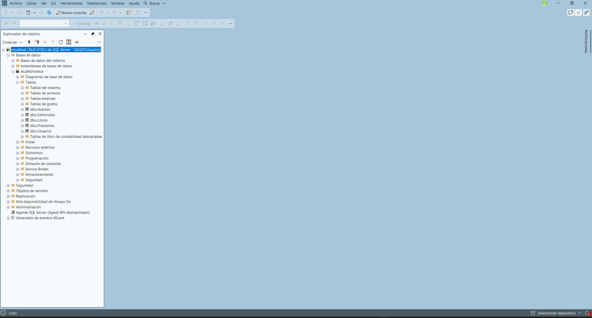
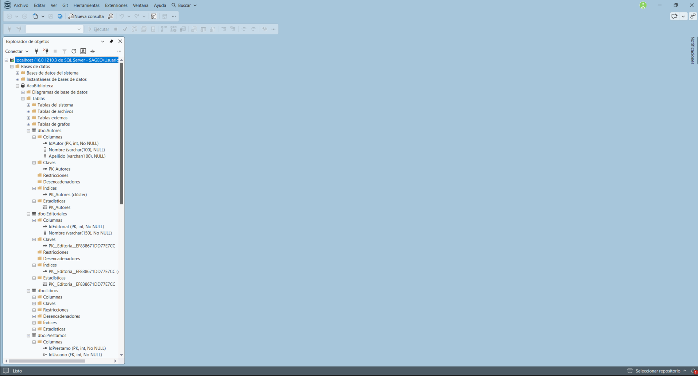
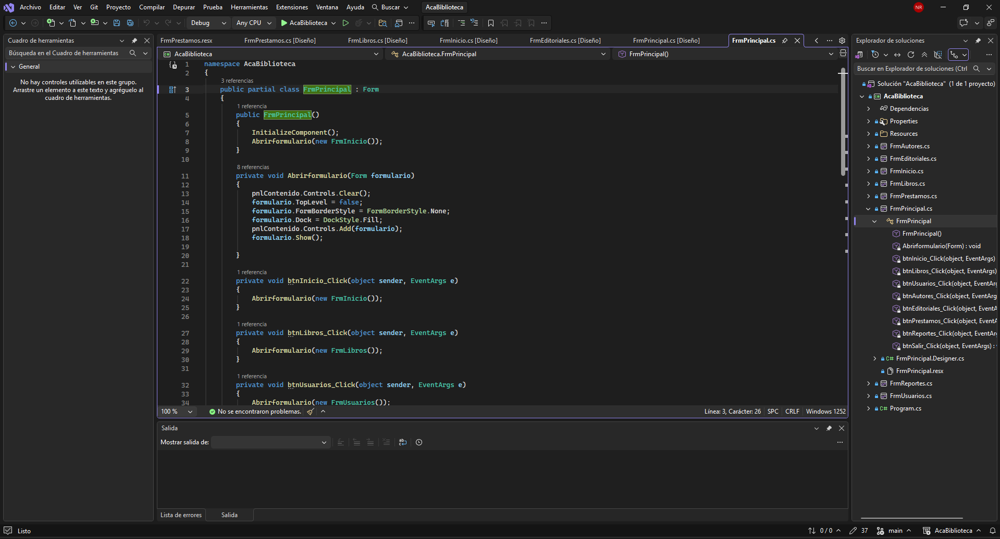
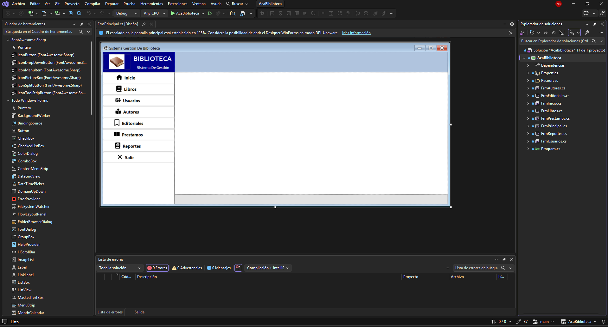
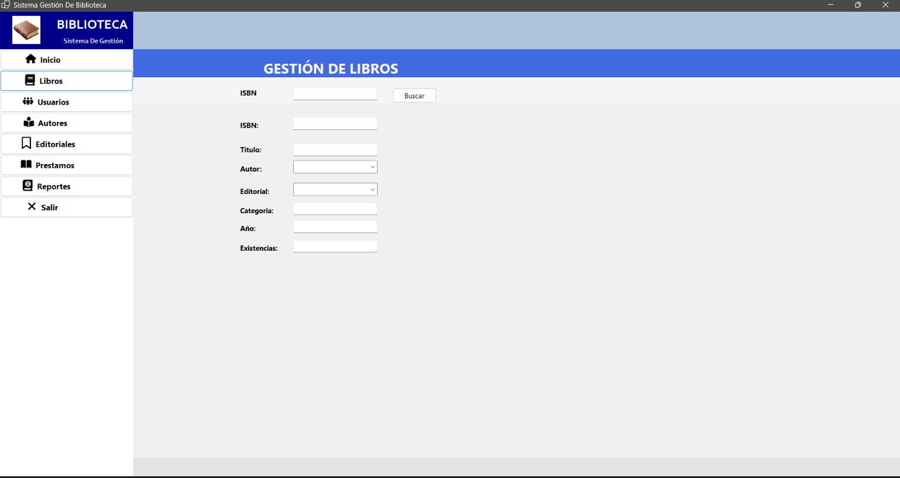

# Sistema de Gestión de Biblioteca

## PORTADA

**CORPORACIÓN UNIFICADA NACIONAL DE EDUCACIÓN SUPERIOR (CUN)**

**INGENIERÍA DE SISTEMAS / PROGRAMACIÓN AVANZADA**

### ACA -- Programación Avanzada

### Sistema de Gestión de Biblioteca

**Presentado por:**

NORBERTO ANDRÉS MOLANO RUBIO

**Docente:**

VERÓNICA CASTRO MUNAR

**Fecha:**

Ibagué, 22 de octubre del 2026

## CONTRAPORTADA

**Sistema de Gestión de Biblioteca**

Proyecto desarrollado como evidencia del curso de **Programación Avanzada**, aplicando Programación Orientada a Objetos, base de datos relacional, arquitectura por capas, operaciones CRUD, validaciones, manejo de excepciones y conexión con SQL Server.

**Estudiante:** Norberto Andrés Molano Rubio

**Programa:** Ingeniería de Sistemas / Programación Avanzada

**Grupo:** 54467

**Docente:** Verónica Castro Munar

**Institución:** Corporación Unificada Nacional de Educación Superior (CUN)

**Año:** 2026

# TABLA DE CONTENIDO

 1. Introducción

 2. Objetivos

    * 2.1 Objetivo general

    * 2.2 Objetivos específicos

 3. Planteamiento del problema

 4. Análisis de requerimientos

 5. Casos de uso

 6. Diagrama de clases

 7. Modelo entidad-relación

 8. Diccionario de datos

 9. Arquitectura del sistema

10. Explicación de los módulos desarrollados

11. Capturas de pantalla del sistema

12. Pruebas de funcionamiento

13. Conclusiones

14. Recomendaciones

15. Referencias bibliográficas

# 1. INTRODUCCIÓN

El presente documento describe el desarrollo del **Sistema de Gestión de Biblioteca**, una aplicación de escritorio desarrollada para la administración centralizada y eficiente de libros, autores, categorías, usuarios, préstamos y devoluciones.

El sistema fue desarrollado utilizando **C#, .NET, Windows Forms y SQL Server**, aplicando principios de Programación Orientada a Objetos (POO) y una arquitectura por capas para garantizar mantenibilidad, escalabilidad y una experiencia de usuario fluida.

# 2. OBJETIVOS

## 2.1 Objetivo general

Desarrollar un Sistema de Gestión de Biblioteca que permita administrar eficazmente los registros y operaciones de la biblioteca mediante Programación Orientada a Objetos, una base de datos relacional SQL Server y una arquitectura por capas.

## 2.2 Objetivos específicos

* Diseñar e implementar una aplicación de escritorio intuitiva en Windows Forms.

* Aplicar principios fundamentales de Programación Orientada a Objetos (encapsulamiento, abstracción y modularidad).

* Diseñar e implementar una base de datos relacional optimizada en SQL Server.

* Implementar operaciones CRUD completas para las entidades principales del sistema.

* Implementar validaciones de datos estrictas en la interfaz y en las capas lógicas.

* Garantizar el manejo controlado de excepciones para evitar fallos inesperados.

* Utilizar Git y GitHub Desktop para el control de versiones y documentación del proyecto.

# 3. PLANTEAMIENTO DEL PROBLEMA

## 3.1 Descripción del problema

La biblioteca presenta dificultades para controlar de manera organizada la información de libros, autores, usuarios y préstamos. El manejo manual o desestructurado genera duplicidad de registros, pérdida de datos e incertidumbre sobre la disponibilidad real de los ejemplares.

## 3.2 Justificación

La implementación del sistema automatizado reduce el tiempo de atención al usuario, previene inconsistencias en inventario y permite llevar un registro fidedigno de los préstamos activos y su estado de devolución.

## 3.3 Alcance

El sistema permite gestionar libros, autores, categorías, usuarios y controlar el registro de préstamos y devoluciones con cálculo de disponibilidad en tiempo real.

# 4. ANÁLISIS DE REQUERIMIENTOS

## 4.1 Actores del sistema

| Actor | Descripción | 
| ----- | ----- | 
| **Bibliotecario / Administrador** | Usuario responsable de gestionar registros de libros, usuarios, autores, procesar préstamos y registrar devoluciones. | 

## 4.2 Requerimientos funcionales

| Código | Requerimiento | Descripción | 
| ----- | ----- | ----- | 
| RF01 | Gestionar libros | Registrar, consultar, actualizar, eliminar y buscar libros por ISBN o título. | 
| RF02 | Gestionar autores | Registrar, consultar, actualizar y eliminar autores. | 
| RF03 | Gestionar categorías | Registrar, consultar, actualizar y eliminar categorías. | 
| RF04 | Gestionar usuarios | Registrar, consultar, actualizar y eliminar usuarios del sistema. | 
| RF05 | Registrar préstamos | Registrar préstamos vinculando usuario y libro, actualizando la disponibilidad. | 
| RF06 | Registrar devoluciones | Registrar devoluciones y restablecer la disponibilidad del libro. | 

## 4.3 Reglas de negocio

* **RN01 -- ISBN / Código único:** No se permite registrar dos libros con el mismo identificador.

* **RN02 -- Datos obligatorios:** Se validan campos requeridos antes de procesar inserciones o cambios.

* **RN03 -- Disponibilidad:** No se puede prestar un libro si su existencia es igual a cero.

# 5. CASOS DE USO

El administrador interactúa con la interfaz de Windows Forms cargando submódulos dentro del panel principal contenedor (`pnlContenido`).

# 6. DIAGRAMA DE CLASES Y POO

Se definieron entidades como `Libro`, `Autor`, `Categoria`, `Usuario` y `Prestamo` con propiedades encapsuladas, métodos de acceso y estructuras modulares para separar la capa de datos de la interfaz de usuario.

# 7. MODELO ENTIDAD-RELACIÓN

Estructura relacional en SQL Server enlazando tablas de Autores, Categorías, Libros, Usuarios y Préstamos mediante llaves primarias y foráneas que garantizan integridad referencial.

# 8. DICCIONARIO DE DATOS

| Campo | Tipo de dato | Clave | Nulo | Descripción | 
| ----- | ----- | ----- | ----- | ----- | 
| idLibro | INT | PK | No | Identificador único del libro. | 
| codigo | VARCHAR(20) | UQ | No | Código o ISBN único. | 
| titulo | VARCHAR(200) | \- | No | Título del libro. | 
| idAutor | INT | FK | No | Autor asociado. | 
| idCategoria | INT | FK | No | Categoría asociada. | 
| cantidad | INT | \- | No | Stock / Existencias disponibles. | 

# 9. ARQUITECTURA DEL SISTEMA

El proyecto se organiza en una arquitectura por capas:

1. **Capa de Presentación:** Formularios en C# Windows Forms (`FrmPrincipal`, `FrmLibros`, etc.).

2. **Capa de Lógica de Negocio:** Controladores y validaciones de datos.

3. **Capa de Acceso a Datos:** Objetos de acceso a datos (DAO) e hilos de conexión SQL Server.

4. **Capa de Base de Datos:** Motor SQL Server.

# 10. EXPLICACIÓN DE LOS MÓDULOS DESARROLLADOS

* **Módulo de Menú Principal (FrmPrincipal):** Contenedor dinámico con menú lateral para navegar entre pantallas.

* **Módulo de Libros (FrmLibros):** Gestión completa de inventario de libros con búsqueda por ISBN y edición de stock.

# 11. CAPTURAS DE PANTALLA DEL SISTEMA

En esta sección se presentan las evidencias de la interfaz gráfica desarrollada en C# (Windows Forms) y su comportamiento dentro del sistema.

## 11.1 Menú Principal (FrmPrincipal)

**Descripción:** Pantalla principal del sistema `AcaBiblioteca` diseñada bajo un modelo de contenedor dinámico. En la parte izquierda cuenta con un menú de navegación estilizado con botones para acceder a los distintos módulos (Inicio, Libros, Usuarios, Autores, Editoriales, Préstamos, Reportes y Salir). Al presionar cada botón, el formulario correspondiente se carga dinámicamente en el panel central `pnlContenido`.

## 11.2 Módulo de Gestión de Libros (FrmLibros)

**Descripción:** Interfaz del subformulario `FrmLibros` desplegada dentro del panel contenedor `pnlContenido`. Incluye los controles para la búsqueda por ISBN (caja de texto y botón `Buscar`), así como los campos para la captura y edición de información de los libros: ISBN, Título, Autor (`ComboBox`), Editorial (`ComboBox`), Categoría, Año y Existencias.

# 12. PRUEBAS DE FUNCIONAMIENTO

| ID | Funcionalidad | Acción / Entrada | Resultado Esperado | Estado | 
| ----- | ----- | ----- | ----- | ----- | 
| CP01 | Registrar Libro | Ingresar ISBN y datos completos | Libro registrado e inventario actualizado | Aprobado | 
| CP02 | Búsqueda por ISBN | Ingresar ISBN en FrmLibros | Desplegar información en campos correspondientes | Aprobado | 

### Evidencia de Pruebas

# 13. CONCLUSIONES

* Se logró desarrollar una solución funcional y robusta para la administración de bibliotecas utilizando C# y Windows Forms.

* La arquitectura por capas facilitó la separación entre la interfaz visual y la manipulación de datos en SQL Server.

* La inclusión de controles dinámicos mejoró notablemente la experiencia de navegación del usuario.

# 14. RECOMENDACIONES

* Implementar un módulo de reportes exportables en formato PDF o Excel.

* Añadir autenticación de usuarios por roles (Administrador vs. Auxiliar).

# 15. REFERENCIAS BIBLIOGRÁFICAS

* Microsoft. (2026). *Windows Forms App (.NET Framework) Documentation*. Microsoft Learn.

* Corporación Unificada Nacional de Educación Superior (CUN). (2026). *Guía de desarrollo para ACA - Programación Avanzada*.
